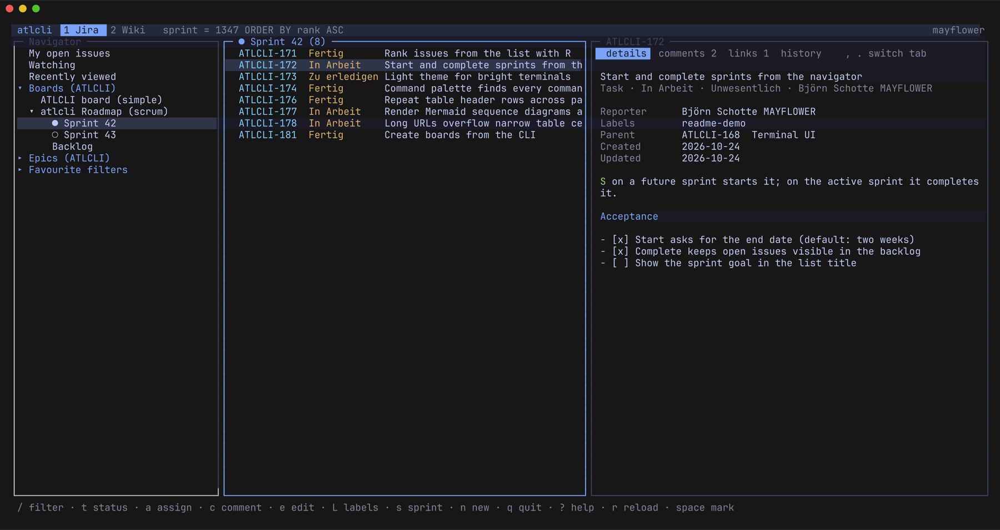
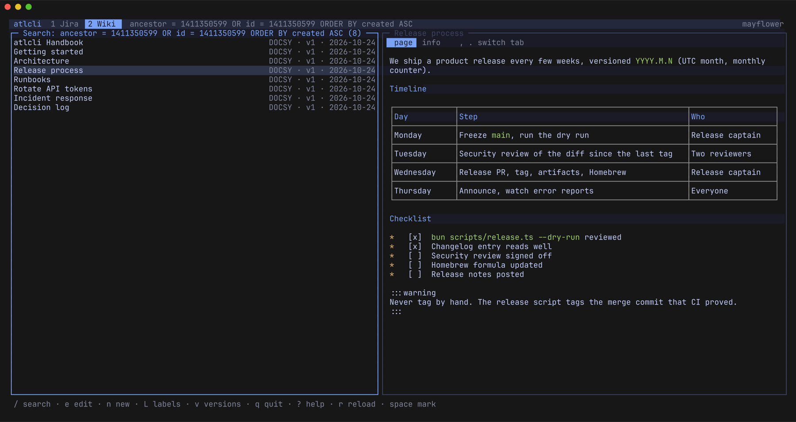
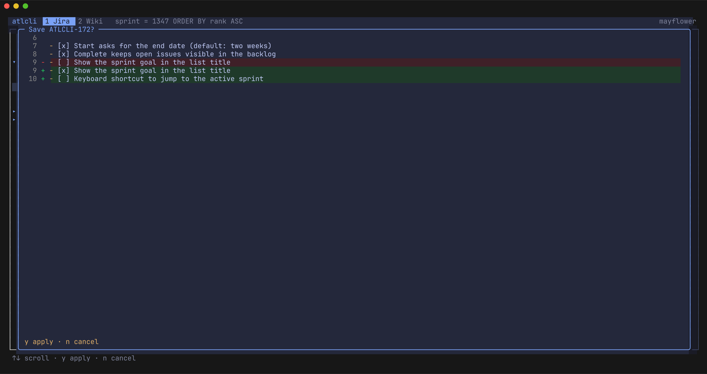
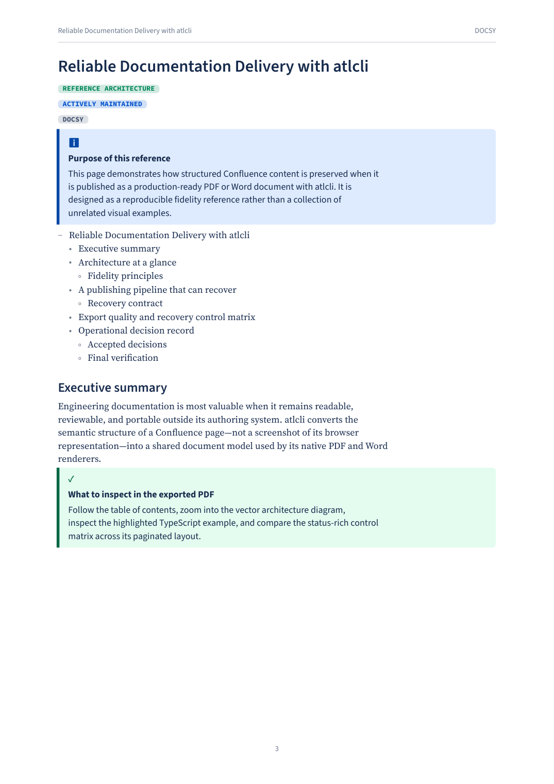
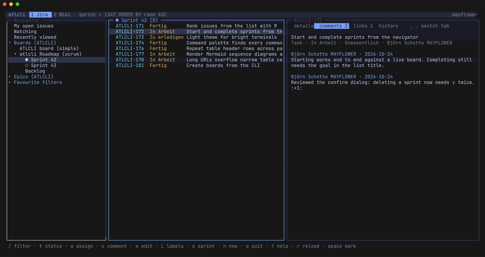
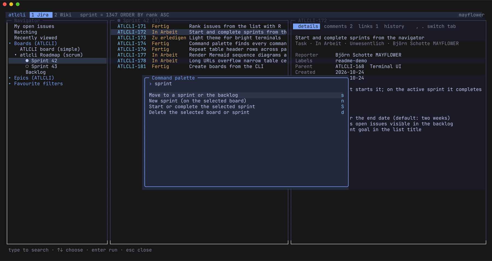
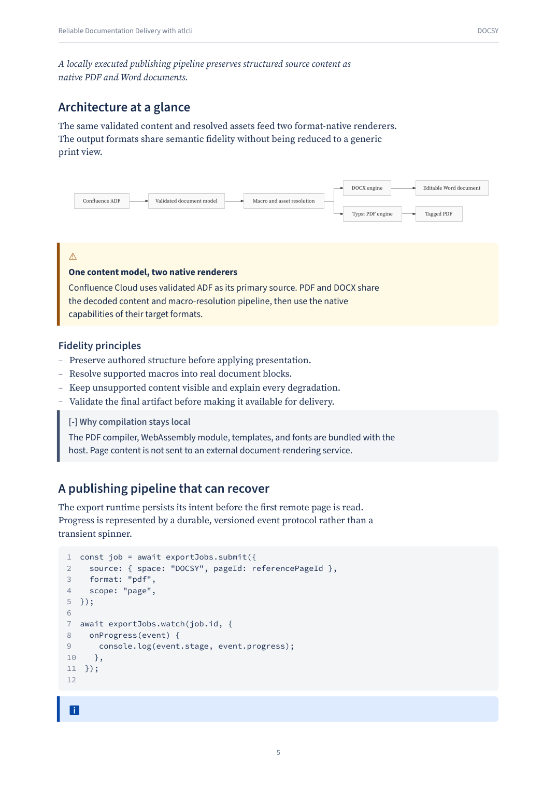
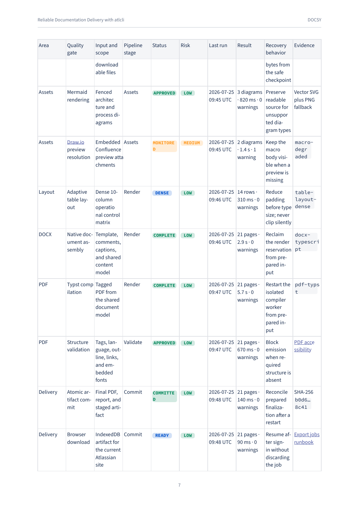

# atlcli

**Confluence and Jira in your terminal, your browser and your CI pipeline.**

Browse and edit Jira issues and Confluence pages in a fullscreen terminal UI, run
boards and sprints from the command line, keep Confluence spaces as Markdown in
Git, and export pages and page trees to **publication-grade PDF and Word** — from
the CLI or locally in a Chrome side panel.

[Documentation](https://atlcli.sh/) ·
[Getting started](https://atlcli.sh/getting-started/) ·
[CLI reference](https://atlcli.sh/reference/cli-commands/)

[](https://github.com/BjoernSchotte/atlcli/actions)
[](https://github.com/BjoernSchotte/atlcli/releases)
[](LICENSE)
[](https://atlcli.sh/)

## Quick install

```bash
brew install bjoernschotte/tap/atlcli        # or: curl -fsSL https://atlcli.sh/install.sh | bash
atlcli auth init                             # connect your Atlassian site
atlcli tui                                   # Jira and Confluence, fullscreen
```

Prebuilt for macOS, Linux and Windows. Manual downloads, checksums and the
development channel: [Install](#install).

| Jira in the terminal | Confluence in the terminal |
|---|---|
|  |  |
| **Every change shows a diff first** | **Publication-grade PDF** |
|  |  |

- **Start:** [Terminal UI](#terminal-ui) · [PDF and Word export](#publication-grade-pdf-and-word) · [In your browser](#in-your-browser) · [Install](#install)
- **Work:** [Jira from the command line](#jira-from-the-command-line) · [Confluence as code](#confluence-as-code) · [Confluence as a filesystem](#confluence-as-a-filesystem) · [Static web publishing](#static-web-publishing)
- **Automate:** [Scripts, CI and agents](#built-for-scripts-ci-and-agents) · [Agent skill](#agent-skill) · [Documentation](#documentation)

## Terminal UI

`atlcli tui` opens Jira and Confluence side by side in one fullscreen terminal:
a navigator, a list and a detail pane, with the keyboard or the mouse.

- **Jira:** your open issues, boards with their sprints and backlog, epics and
  favourite filters. Filter with `jira search` flags or JQL, sort, mark issues
  for bulk changes. Transition, assign, comment, edit in `$EDITOR`, label, move
  to a sprint, set the epic, create and clone.
- **Agile:** see a sprint as a board and move cards across its columns; create
  boards and sprints from the navigator, start and complete sprints, and reorder
  the backlog with `R`.
- **Confluence:** spaces and their page trees, CQL search, every page as the same
  Markdown `wiki docs pull` writes. Edit in `$EDITOR`, add child pages, labels,
  move pages, compare versions.
- **Safe by design:** every write lists what it changes and asks first; a page
  someone saved meanwhile is never overwritten.
- **Learn the CLI as you go:** `!` lists every change you made as the `atlcli`
  command that does the same, ready to paste into a script.
- **Yours:** `?` shows the keys of the focused pane, `:` finds every command by
  name; saved views, lists that refresh while you look, light and dark themes,
  configurable keys and columns.

| The active sprint, with comments | One palette for every command |
|---|---|
|  |  |

[Explore the terminal UI →](https://atlcli.sh/tui/)

## Publication-grade PDF and Word

atlcli does not print a web page or flatten Confluence into a screenshot. It
interprets the document and writes real, structured PDF and Word files — one
page, a page tree or a whole space in a single document.

<p align="center">
  
</p>

<p align="center"><em>Images remain sharp, color-managed document content — not browser screenshots.</em></p>

<table>
  <tr>
    <td width="50%">
      
    </td>
    <td width="50%">
      
    </td>
  </tr>
  <tr>
    <td align="center"><em>Mermaid, Expand, and Shiki code</em></td>
    <td align="center"><em>Dense tables keep every value, link and badge</em></td>
  </tr>
</table>

- **Real Confluence content** — layouts, panels, status badges, mentions, Smart
  Links, task lists, inline comments, attachments and emoji keep their meaning.
- **Tables that fit** — authored widths, merged cells and repeated header rows;
  dense tables scale deterministically instead of being clipped.
- **Macros, diagrams and charts** — TOC, Expand, Jira issue tables, Draw.io and
  Gliffy; Mermaid and Confluence charts as vector graphics from their real data.
- **Tagged PDFs, native Word** — a Typst engine writes tagged PDFs with
  bookmarks, embedded fonts and alt text; Word files use native TOC fields,
  comments and sections, from your own templates.
- **No silent content loss** — anything that cannot render falls back visibly,
  and the export report lists what rendered, degraded or was skipped.

```bash
atlcli wiki export 12345 --scope tree --output handbook.pdf
```

[Open the nine-page PDF fidelity reference →](assets/readme/atlcli-confluence-export-reference.pdf) ·
[Explore DOCX and PDF export →](https://atlcli.sh/confluence/export/)

## In your browser

The atlcli Chrome extension exports the Confluence Cloud page you are reading to
Word or PDF in a side panel — with the session you are already signed in with,
no API token needed.

- **Local by design:** the PDF compiler, fonts and export engines ship inside the
  extension. Page content never goes to an external rendering service.
- **Preview and brand:** preview the PDF before you download it, and keep
  document branding and template sets per space.
- **Leave it running:** exports continue in the background when you close the
  panel or navigate away, and resume after a browser restart. The Activity view
  shows every job, with retry and **Resume after sign-in**.

The extension installs from the release ZIP and needs Chrome 140 or newer.

| Use the CLI when you need… | Use the extension when you need… |
| --- | --- |
| Repeatable, scriptable exports | A one-off export of the page you are viewing |
| CI and headless automation | A PDF preview before download |
| JSON reports and classified exit codes | Visual PDF settings and branding |
| Cloud or Data Center | Your existing Confluence Cloud session |

[Explore the browser extension →](https://atlcli.sh/extension/)

## Jira from the command line

```bash
atlcli jira search --assignee me --status "In Progress"
atlcli jira issue create --project TEAM --type Task --summary "Rotate CI tokens" --edit
atlcli jira board create --name "Team board" --project TEAM
atlcli jira sprint start --id 42 --end 2026-11-07
atlcli jira issue rank TEAM-7 TEAM-8 --before TEAM-1
atlcli jira bulk move --jql "project = TEAM AND labels = q4" --sprint 42 --dry-run
```

Issues, comments, links and attachments; boards, sprints, backlog, epics and
ranking; bulk changes with dry runs; issue templates; flow analytics and sprint
reports; timer-based time tracking.

[Explore Jira workflows →](https://atlcli.sh/jira/)

## Confluence as code

Pull a space into a Markdown workspace, edit it with your usual tools, and push
it back with conflict detection. Page hierarchy, attachments, macros, labels and
frontmatter stay part of the workflow.

```bash
atlcli wiki docs init ./team-docs --space TEAM
cd team-docs && atlcli wiki docs pull
atlcli wiki docs status
atlcli wiki docs push --validate
```

[Explore Confluence workflows →](https://atlcli.sh/confluence/)

## Confluence as a filesystem

Spaces are directories, pages are directories with an `_index.md`, and `ls`,
`cat`, `grep` and `sed` work on them — in a shell, or as a mounted volume. No MCP
server, no tool calls.

```bash
atlcli wiki sh --space DOCS -c 'grep -rlw kubernetes . | head -5'
atlcli wiki mount ~/confluence --space DOCS
```

It is a cache, not a copy: only what you read reaches the disk. Writing is off by
default (`--mode rw` enables it), and deletion always goes to the trash.

[Explore the virtual filesystem →](https://atlcli.sh/confluence/virtual-filesystem/)

## Static web publishing

Build a page tree or a space into a verified static Astro site, with Starlight or
a plain Astro render kit and local Pagefind search.

```bash
atlcli wiki publish run --project .atlcli/publish.json --profile work
```

[Explore Astro web publishing →](https://atlcli.sh/publishing/)

## Built for scripts, CI and agents

- Human-readable output by default, stable `--json` for scripts
- Validation and strict modes, classified exit codes and export reports for CI
- Named profiles for several Atlassian sites, Cloud and Data Center
- `atlcli doctor` checks configuration, credentials and permissions
- Bash and Zsh completion, and a plugin system

| Workflow | Start here |
| --- | --- |
| Browse Jira and Confluence | `atlcli tui` |
| Search and manage Jira | `atlcli jira --help` |
| Sync Confluence and Markdown | `atlcli wiki docs --help` |
| Work on Confluence with a shell | `atlcli wiki sh --help` |
| Export DOCX or PDF | `atlcli wiki export --help` |
| Diagnose configuration | `atlcli doctor` |
| Teach an agent atlcli | `atlcli skill --install .claude/skills` |

## Agent skill

atlcli ships an agent skill that teaches a coding agent the CLI: the flag
grammar, JSON output and error codes, and the rule to confirm every write with
the user. It lives in [`skills/atlcli/`](skills/atlcli/), and every binary
carries a copy:

```bash
atlcli skill --install .claude/skills   # writes .claude/skills/atlcli/
```

See [Agent Skill](https://atlcli.sh/reference/agent-skill/) and
[Confluence for Coding Agents](https://atlcli.sh/recipes/confluence-vfs-agents/).

## Install

```bash
# macOS or Linux
curl -fsSL https://atlcli.sh/install.sh | bash

# Homebrew
brew install bjoernschotte/tap/atlcli

# A green-main development build instead (conflicts with the stable formula)
brew install bjoernschotte/tap/atlcli-dev
```

Then connect a site and check it:

```bash
atlcli auth init
atlcli doctor
```

Windows binaries, manual downloads, checksums and the packaged extension are in
the [installation guide](https://atlcli.sh/getting-started/#installation) and
[Development releases](https://atlcli.sh/reference/dev-releases/).

## Documentation

The complete documentation lives at **[atlcli.sh](https://atlcli.sh/)**:
[Getting started](https://atlcli.sh/getting-started/) ·
[Authentication](https://atlcli.sh/authentication/) ·
[Terminal UI](https://atlcli.sh/tui/) ·
[Confluence](https://atlcli.sh/confluence/) ·
[DOCX and PDF export](https://atlcli.sh/confluence/export/) ·
[Jira](https://atlcli.sh/jira/) ·
[Recipes](https://atlcli.sh/recipes/) ·
[CLI reference](https://atlcli.sh/reference/cli-commands/) ·
[Troubleshooting](https://atlcli.sh/reference/troubleshooting/)

## Development

atlcli is a Bun workspace monorepo.

```bash
bun install
bun run build
bun run test
bun run typecheck
bun --conditions=development run --cwd apps/cli src/index.ts --help   # the CLI from source
```

The README screenshots come from `scripts/readme/` (demo content on a test site,
then the real TUI in tmux). See the
[contributing guide](https://atlcli.sh/contributing/) for structure, testing,
documentation and releases.

## License

Licensed under the [Apache License 2.0](LICENSE). See [NOTICE](NOTICE) for
additional attribution.

Jira and Confluence are trademarks of Atlassian Corporation Plc, registered in
the US and other countries. atlcli is not affiliated with, endorsed by, or
sponsored by Atlassian.
