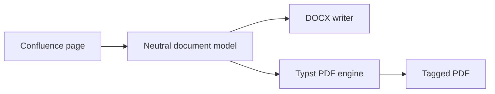

atlcli is a Bun monorepo: one CLI on top of small, typed packages.

## Packages

| Package | Responsibility |
|---|---|
| `apps/cli` | Commands, flags, output and exit codes |
| `packages/confluence` | REST client, Markdown ↔ storage conversion |
| `packages/jira` | REST and Agile client, JQL helpers |
| `packages/tui` | The fullscreen terminal UI |
| `packages/pdf` | Typst-based PDF engine |

## Export pipeline

Both writers share one content model, so a macro that renders in PDF renders in Word too.

:::note
The browser extension runs the same engines locally — no page content leaves the browser.
:::
